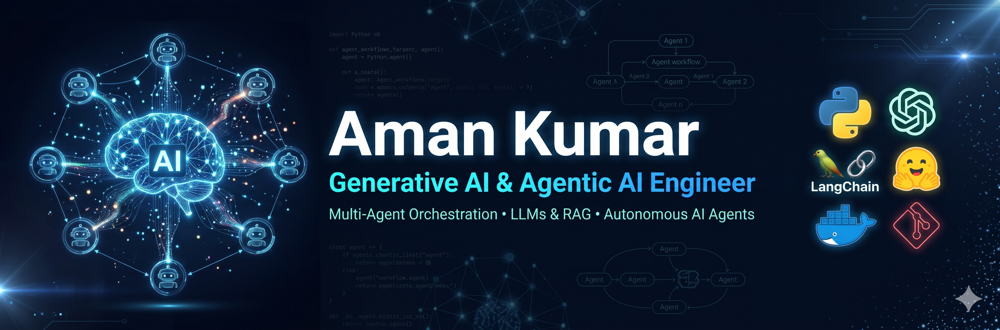

<!-- Custom Banner Image -->

  

 

<!-- Interactive Contact & Social Badges -->

  
  
  

 

<h2 align="center">Agentic AI & Generative AI Engineer</h2>

  Developing production-grade autonomous agent workflows, scalable multi-agent orchestrations, and advanced Retrieval-Augmented Generation (RAG) pipelines for enterprise platforms like TCS AI WisdomNext. Focused on bridging the gap between state-of-the-art LLMs and robust full-stack applications.

 

### ⚙️ Core Architecture & Tech Stack

| 🤖 Agentic AI & LLMs | 🧠 Vector & RAG | 🔌 Backend & DB | 💻 Frontend & Ops |
| :--- | :--- | :--- | :--- |
| LangGraph, CrewAI | LlamaIndex, pgvector | Python, Flask, MCP | Angular, TypeScript |
| AutoGen, LangChain | GraphRAG, Hybrid Search | RESTful APIs, SQLAlchemy| Docker, Git |
| Open-Source Models | Context Window Mgt. | Postgres, Connection Pools| UI Integration |

 

### 🚀 High-Impact Engineering

| Repository | Focus Area | Technical Stack |
| :--- | :--- | :--- |
| **[Multi-Agent-System](link-to-your-repo)** | Autonomous workflows & self-correcting agent routing | Python, LangGraph, CrewAI |
| **[Enterprise-RAG](link-to-your-repo)** | Advanced context retrieval and hallucination mitigation | LlamaIndex, PostgreSQL |
| **[AI-API-Backend](link-to-your-repo)** | Secure model context protocol and scalable routing | Flask, SQLAlchemy |
| **[Trading-Backtest](link-to-your-repo)** | OHLC time-series data processing & strategy metrics | Pandas, NumPy, Matplotlib |

 

